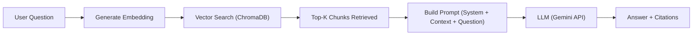
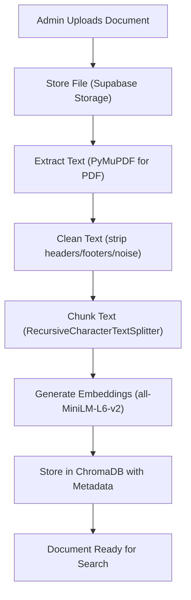

# Enterprise Knowledge Management System
## RAG-Powered AI Chat for Organizational Knowledge

**Version:** 2.2 — Academic Edition (Supabase)  
**Team Size:** 4 members  
**Target Duration:** 8–10 weeks  
**Last Updated:** July 13, 2026

---

## 1. Product Overview

An AI-powered internal platform that lets employees ask natural language questions and get accurate, cited answers from organizational documents — powered by Retrieval-Augmented Generation (RAG).

Instead of searching through hundreds of PDFs and policy documents manually, employees type a question and the AI retrieves the most relevant passages, generates a grounded answer, and cites exactly which document and page the information came from.

---

## 2. Problem Statement

| Problem | How We Solve It |
|:--|:--|
| Employees waste hours searching for documents | AI-powered semantic search finds answers in seconds |
| Inconsistent answers from colleagues | Single source of truth with cited responses |
| Outdated documents get used by mistake | Centralized, version-managed document repository |
| Same questions asked to HR repeatedly | AI handles repetitive queries automatically |
| Hard to find specific policies | Natural language Q&A instead of keyword guessing |

---

## 3. Scope — What We're Building vs. Not Building

> [!IMPORTANT]
> This is the scoped version. We build 10 high-impact modules and defer 5 complex modules to "Future Work" (great for your presentation's roadmap slide).

### ✅ In Scope (10 Modules)

| # | Module | Priority | Complexity |
|:--|:--|:--|:--|
| 1 | Authentication (Supabase Auth) | 🔴 Critical | Easy |
| 2 | AI Chat with RAG | 🔴 Critical | Medium |
| 3 | Document Upload & Processing Pipeline | 🔴 Critical | Medium |
| 4 | Semantic + Keyword Search | 🔴 Critical | Medium |
| 5 | Employee Dashboard | 🟡 High | Easy |
| 6 | Admin Dashboard (Basic Analytics) | 🟡 High | Easy |
| 7 | User Management (CRUD) | 🟡 High | Easy |
| 8 | Role-Based Access Control | 🟡 High | Medium |
| 9 | Feedback System (👍/👎) | 🟢 Medium | Easy |
| 10 | Prompt Management (Admin Config) | 🟢 Medium | Easy |

### ❌ Deferred to Future Work

| Module | Reason for Deferral |
|:--|:--|
| Document Comparison (Diff View) | Complex UI + diffing logic, low demo impact |
| AI Document Summary | Nice-to-have, not core RAG functionality |
| Detailed Audit Logs | Tedious to build, not impressive in demo |
| Multi-Factor Authentication | Overkill for academic scope |
| Advanced Analytics (weekly/monthly trends) | Basic counts and charts are sufficient |

---

## 4. Target Users

| Role | What They Do |
|:--|:--|
| **Employee** | Searches documents, chats with AI, gives feedback |
| **Admin** | Manages users, uploads documents, configures AI, views analytics |

> [!TIP]
> Two roles are sufficient. Keep it simple — don't over-engineer role hierarchies.

---

## 5. User Permissions

### Employee

| Action | Allowed |
|:--|:--|
| Login / Logout | ✅ |
| Chat with AI | ✅ |
| Search documents | ✅ |
| View accessible documents | ✅ |
| Bookmark / rename / delete chats | ✅ |
| Rate AI responses (👍/👎) | ✅ |
| Upload / delete documents | ❌ |
| Manage users | ❌ |

### Admin

| Action | Allowed |
|:--|:--|
| Everything an Employee can do | ✅ |
| Upload / delete / tag documents | ✅ |
| Add / remove / disable users | ✅ |
| Assign roles and departments | ✅ |
| Configure AI prompt settings | ✅ |
| View analytics dashboard | ✅ |

---

## 6. Functional Requirements

### Module 1 — Authentication (Supabase Auth)

- Email + password login via **Supabase Auth**
- Session management handled by Supabase (JWT tokens auto-managed)
- Forgot password / magic link — built-in, no custom code needed
- Protected routes on frontend using `supabase.auth.getSession()`
- Protected routes on backend by verifying Supabase JWT in FastAPI middleware
- Optional: Google OAuth login (one-click setup in Supabase dashboard)

**How it works:**
```
Frontend (React)
├── supabase.auth.signUp({ email, password })     → Register
├── supabase.auth.signInWithPassword({ ... })     → Login
├── supabase.auth.signOut()                        → Logout
├── supabase.auth.resetPasswordForEmail(email)     → Forgot Password
└── supabase.auth.getSession()                     → Get current user

Backend (FastAPI)
└── Middleware validates Supabase JWT token on every /api/* request
```

> [!TIP]
> Supabase Auth handles registration, login, logout, password reset, email verification, and session tokens **out of the box**. You write zero auth backend code — just verify the JWT in FastAPI middleware.

---

### Module 2 — AI Chat (Core Feature ⭐)

This is the **centerpiece** of the project. Build this first.

**Employee can:**
- Ask natural language questions
- Get AI-generated answers with source citations
- Continue multi-turn conversations
- View chat history
- Bookmark, rename, delete conversations

**AI behavior:**
- Retrieve top-K relevant chunks from the vector database
- Assemble context and send to LLM with system prompt
- Generate grounded answer citing `[Document Name, Page X]`
- Maintain conversation context within a session

**RAG flow:**



**API endpoints:**
```
POST   /api/chat/ask
GET    /api/chat/conversations
GET    /api/chat/conversations/{id}
PUT    /api/chat/conversations/{id}/rename
DELETE /api/chat/conversations/{id}
POST   /api/chat/conversations/{id}/bookmark
```

---

### Module 3 — Document Upload & AI Processing Pipeline

**Supported formats:** PDF, TXT

> [!TIP]
> Start with PDF + TXT only. These cover 90% of enterprise documents. Adding DOCX/PPTX/XLSX later is straightforward but adds complexity for little demo value.

**Upload flow:**



**Chunk configuration:**
- Chunk size: 500 tokens
- Chunk overlap: 50 tokens
- Metadata per chunk: `document_id`, `page_number`, `department`, `tags`

**API endpoints:**
```
POST   /api/documents/upload
GET    /api/documents
GET    /api/documents/{id}
DELETE /api/documents/{id}
PUT    /api/documents/{id}/tags
```

---

### Module 4 — Document Search

**Two search modes:**
- **Semantic search** — vector similarity via ChromaDB
- **Keyword search** — Supabase PostgreSQL full-text search (`tsvector`)

**Filters:**

| Filter | Type |
|:--|:--|
| Department | Dropdown (HR, Engineering, Finance, etc.) |
| Document Type | Checkbox (PDF, TXT) |
| Upload Date | Date range picker |
| Tags | Multi-select tags |

**API endpoints:**
```
GET    /api/search?q={query}&type=semantic|keyword
GET    /api/search?department=HR&tags=policy
```

---

### Module 5 — Employee Dashboard

A single-page dashboard after login showing:

| Widget | Data Source |
|:--|:--|
| Recent Chats (last 5) | Chat history API |
| Recent Documents (last 5) | Document access log |
| Quick Search Bar | Links to search |
| Bookmarked Chats | Bookmark API |
| Announcements | Admin-posted notices (simple table) |

---

### Module 6 — Admin Dashboard

| Metric | Implementation |
|:--|:--|
| Total Users | `supabase.from('profiles').select('*', { count: 'exact' })` |
| Total Documents | `supabase.from('documents').select('*', { count: 'exact' })` |
| Total AI Queries | `supabase.from('chat_messages').select('*', { count: 'exact' })` |
| Avg. Response Time | Track in `chat_messages` table |
| Feedback Summary | Aggregate 👍/👎 counts |
| Top 5 Documents | Most accessed documents |
| Top 5 Questions | Most asked queries |

> [!TIP]
> Use a charting library like **Recharts** (React) to make simple bar/pie charts. Don't build complex analytics — basic counts and charts are impressive enough.

---

### Module 7 — User Management

Admin CRUD for users — uses **Supabase Auth Admin SDK** + a `profiles` table:

| Action | Implementation |
|:--|:--|
| Add User | `supabase.auth.admin.createUser()` + insert into `profiles` |
| Edit User | Update `profiles` table (role, department) |
| Disable/Enable User | `supabase.auth.admin.updateUserById(id, { banned: true/false })` |
| Delete User | `supabase.auth.admin.deleteUser(id)` + soft-delete in `profiles` |

**How it works:**
```
Supabase Auth         →  Manages email, password, login status
profiles table        →  Stores role, department, display name, is_active
(linked via user id)
```

> [!NOTE]
> Supabase Auth stores credentials securely. Your `profiles` table extends it with app-specific fields (role, department). The two are linked by the user's UUID.

---

### Module 8 — Role-Based Access Control (Supabase RLS)

**Simple 2-role + department model:**

```
profiles table:
  - role: "employee" | "admin"
  - department: "HR" | "Engineering" | "Finance" | "Legal" | "Operations"
```

**Access rules:**
- Employees can only search/view documents tagged for their department (or tagged "All")
- Admins can access all documents
- Document metadata includes `allowed_departments[]`

**Implementation — Supabase Row-Level Security (RLS):**

```sql
-- Employees can only read documents for their department
CREATE POLICY "employees_read_own_dept" ON documents
  FOR SELECT
  USING (
    auth.uid() IN (
      SELECT id FROM profiles WHERE role = 'admin'
    )
    OR 'All' = ANY(allowed_departments)
    OR (
      SELECT department FROM profiles WHERE id = auth.uid()
    ) = ANY(allowed_departments)
  );
```

> [!TIP]
> RLS policies run at the **database level**, so even if someone bypasses the frontend, they still can't access restricted documents. This is much more secure than middleware-only checks.

---

### Module 9 — Feedback System

On every AI response, show:

| Button | Action |
|:--|:--|
| 👍 | Mark response as helpful |
| 👎 | Mark response as not helpful |
| 💬 | Optional comment text field |

Store in a `feedback` table (Supabase):
```sql
CREATE TABLE feedback (
    id UUID DEFAULT gen_random_uuid() PRIMARY KEY,
    message_id UUID REFERENCES chat_messages(id),
    user_id UUID REFERENCES auth.users(id),
    rating VARCHAR(10),  -- 'helpful' or 'not_helpful'
    comment TEXT,
    created_at TIMESTAMPTZ DEFAULT now()
);
```

---

### Module 10 — Prompt Management

Admin settings page to configure AI behavior:

| Setting | Type | Default |
|:--|:--|:--|
| System Prompt | Textarea | Pre-written template |
| Temperature | Slider (0.0–1.0) | 0.3 |
| Max Response Tokens | Number input | 512 |
| Top-K Chunks Retrieved | Number input | 5 |
| Citation Format | Dropdown | `[DocName, Page X]` |

Store in a `settings` table (key-value). The RAG pipeline reads these at query time.

---

## 7. Tech Stack (All Free)

| Layer | Tool | Why This One |
|:--|:--|:--|
| **Frontend** | React.js 18 | Industry standard, great ecosystem |
| **Styling** | Tailwind CSS | Fast UI development |
| **Backend** | FastAPI (Python) | AI/RAG routes only — Supabase handles the rest |
| **BaaS (Backend-as-a-Service)** | Supabase (free tier) | Auth, PostgreSQL, Storage, RLS — all in one |
| **Database** | Supabase PostgreSQL | Hosted, managed, free — includes full-text search |
| **Auth** | Supabase Auth | Email/password, OAuth, magic links — zero custom code |
| **File Storage** | Supabase Storage | S3-compatible, 1 GB free — stores uploaded PDFs |
| **RBAC** | Supabase RLS | Row-Level Security policies — database-level access control |
| **Supabase Client (Frontend)** | `@supabase/supabase-js` | React SDK for auth, queries, storage |
| **Supabase Client (Backend)** | `supabase-py` | Python SDK for admin operations in FastAPI |
| **Vector DB** | ChromaDB | Easy setup, Python-native, persistent |
| **Embeddings** | `all-MiniLM-L6-v2` | Fast, runs on CPU, 384-dim vectors |
| **LLM** | Google Gemini API (free tier) | Generous free quota, no GPU needed |
| **RAG Framework** | LangChain | Pipeline orchestration, chunking, retrieval |
| **PDF Parsing** | PyMuPDF (`fitz`) | Fast, reliable PDF text extraction |
| **Charts** | Recharts | React-native charting library |
| **Containerization** | Docker Compose | FastAPI + ChromaDB (Supabase is hosted) |
| **UI Design** | Google Stitch | Free AI-powered UI mockup generation |

> [!IMPORTANT]
> **No GPU required. No database to manage.** Embeddings run on CPU. LLM runs via Gemini API. Database, auth, and file storage are fully managed by Supabase's free tier. Every team member can develop on their laptop with zero infrastructure setup.

### Supabase Free Tier Limits (More Than Enough)

| Resource | Free Tier Limit | Your Usage |
|:--|:--|:--|
| Database | 500 MB | ~50 MB for demo |
| Auth users | 50,000 MAU | < 50 users |
| File storage | 1 GB | ~100 MB of PDFs |
| API requests | Unlimited | Plenty |
| Realtime connections | 200 concurrent | Not needed |
| Edge functions | 500K invocations | Not needed |

---

## 8. Database Schema (Supabase PostgreSQL)

```sql
-- Profiles (extends Supabase auth.users)
CREATE TABLE profiles (
    id UUID REFERENCES auth.users(id) PRIMARY KEY,
    display_name TEXT NOT NULL,
    role TEXT DEFAULT 'employee' CHECK (role IN ('employee', 'admin')),
    department TEXT CHECK (department IN ('HR','Engineering','Finance','Legal','Operations')),
    is_active BOOLEAN DEFAULT true,
    created_at TIMESTAMPTZ DEFAULT now()
);

-- Documents
CREATE TABLE documents (
    id UUID DEFAULT gen_random_uuid() PRIMARY KEY,
    title TEXT NOT NULL,
    filename TEXT NOT NULL,
    storage_path TEXT NOT NULL,          -- Supabase Storage path
    department TEXT,
    tags TEXT[] DEFAULT '{}',
    uploaded_by UUID REFERENCES auth.users(id),
    allowed_departments TEXT[] DEFAULT '{All}',
    created_at TIMESTAMPTZ DEFAULT now()
);

-- Conversations
CREATE TABLE conversations (
    id UUID DEFAULT gen_random_uuid() PRIMARY KEY,
    user_id UUID REFERENCES auth.users(id),
    title TEXT DEFAULT 'New Chat',
    is_bookmarked BOOLEAN DEFAULT false,
    created_at TIMESTAMPTZ DEFAULT now()
);

-- Chat Messages
CREATE TABLE chat_messages (
    id UUID DEFAULT gen_random_uuid() PRIMARY KEY,
    conversation_id UUID REFERENCES conversations(id) ON DELETE CASCADE,
    role TEXT CHECK (role IN ('user', 'assistant')),
    content TEXT NOT NULL,
    sources JSONB DEFAULT '[]',          -- [{doc_id, doc_title, page}]
    response_time_ms INT,
    created_at TIMESTAMPTZ DEFAULT now()
);

-- Feedback
CREATE TABLE feedback (
    id UUID DEFAULT gen_random_uuid() PRIMARY KEY,
    message_id UUID REFERENCES chat_messages(id),
    user_id UUID REFERENCES auth.users(id),
    rating TEXT CHECK (rating IN ('helpful', 'not_helpful')),
    comment TEXT,
    created_at TIMESTAMPTZ DEFAULT now()
);

-- Settings (Admin-configurable AI params)
CREATE TABLE settings (
    id UUID DEFAULT gen_random_uuid() PRIMARY KEY,
    key TEXT UNIQUE NOT NULL,
    value TEXT NOT NULL,
    updated_by UUID REFERENCES auth.users(id),
    updated_at TIMESTAMPTZ DEFAULT now()
);

-- Announcements
CREATE TABLE announcements (
    id UUID DEFAULT gen_random_uuid() PRIMARY KEY,
    title TEXT NOT NULL,
    content TEXT,
    created_by UUID REFERENCES auth.users(id),
    created_at TIMESTAMPTZ DEFAULT now()
);
```

> [!NOTE]
> Supabase uses UUIDs instead of serial integers. The `profiles` table links to `auth.users` (managed by Supabase Auth) via the user's UUID. You create a database trigger to auto-create a profile row on signup.

```sql
-- Auto-create profile on signup
CREATE OR REPLACE FUNCTION public.handle_new_user()
RETURNS TRIGGER AS $$
BEGIN
  INSERT INTO public.profiles (id, display_name)
  VALUES (NEW.id, NEW.raw_user_meta_data->>'display_name');
  RETURN NEW;
END;
$$ LANGUAGE plpgsql SECURITY DEFINER;

CREATE TRIGGER on_auth_user_created
  AFTER INSERT ON auth.users
  FOR EACH ROW EXECUTE FUNCTION public.handle_new_user();
```

---

## 9. Team Allocation

| Member | Role | Responsibilities |
|:--|:--|:--|
| **Person 1** | Backend + Supabase Lead | Supabase project setup, database schema, RLS policies, FastAPI AI routes, Supabase-FastAPI integration |
| **Person 2** | AI/ML Engineer | LangChain pipeline, ChromaDB setup, embedding generation, Gemini integration, RAG tuning |
| **Person 3** | Frontend Developer | React app setup, Supabase Auth UI, employee portal (chat UI, search, dashboard) |
| **Person 4** | Frontend + Admin | Admin dashboard, user management UI (Supabase Admin SDK), document upload to Supabase Storage, analytics charts |

> [!TIP]
> With Supabase handling auth and database, **Person 1** has significantly less boilerplate work. They should use the extra time to help **Person 2** with the RAG pipeline integration or write thorough RLS policies.

**Shared responsibilities (all 4):**
- Docker Compose setup (FastAPI + ChromaDB only — Supabase is hosted)
- Testing
- Documentation
- Final presentation

---

## 10. Development Timeline (10 Weeks)

| Week | Milestone | Who |
|:--|:--|:--|
| **1** | Project setup: Supabase project, database schema + RLS policies, Git repo, React scaffold (use **Google Stitch** for UI mockups), FastAPI skeleton | All |
| **1–2** | Auth complete: Supabase Auth integration on React frontend + FastAPI JWT middleware — **this is fast with Supabase, ~2–3 days** | P1 + P3 |
| **2** | RAG pipeline v1: PDF upload to Supabase Storage → text extraction → chunking → embeddings → ChromaDB | P2 + P1 |
| **3** | Chat API: query → retrieve → LLM → response with citations | P2 |
| **3** | Chat UI: message input, response display, citation links | P3 |
| **4** | Document upload UI (Supabase Storage) + search (semantic + keyword) + filters | P4 + P1 |
| **5** | Employee dashboard (recent chats, documents, search bar, bookmarks) | P3 |
| **5** | Admin dashboard (metrics via Supabase queries, charts with Recharts) | P4 |
| **6** | User management (Supabase Admin SDK) + RLS policy testing | P1 + P4 |
| **7** | Feedback system + prompt management settings page | P3 + P4 |
| **7** | RAG tuning: adjust chunk size, top-K, prompt engineering for better answers | P2 |
| **8** | Integration testing — all modules working end-to-end | All |
| **9** | Bug fixes, UI polish, edge cases, error handling | All |
| **10** | Documentation, demo prep, final presentation | All |

> [!TIP]
> Supabase saves you roughly **1.5–2 weeks** of backend work (auth, DB setup, CRUD APIs, file storage). Use this buffer for RAG quality tuning and UI polish — the two things that matter most in a demo.

---

## 11. Non-Functional Requirements

| Requirement | Target | How |
|:--|:--|:--|
| Response time | < 5 seconds | Gemini API is fast; ChromaDB queries are sub-second |
| Security | Supabase Auth + RLS | Industry-standard auth with database-level access control |
| Availability | Supabase hosted (99.9%) + local FastAPI | Supabase handles uptime; FastAPI runs via Docker |
| Code quality | Clean, documented | ESLint + Black formatter + docstrings |
| API documentation | Auto-generated | FastAPI Swagger UI at `/docs` |

---

## 12. Risk Mitigation

| Risk | Impact | Mitigation |
|:--|:--|:--|
| Gemini API rate limits | Chat stops working | Cache frequent queries; keep responses stored |
| Supabase free tier limits | DB or storage full | 500 MB DB + 1 GB storage is plenty for demo; monitor usage |
| Supabase downtime | App partially broken | Rare (99.9% SLA); FastAPI + ChromaDB still work locally |
| Team member unavailable | Delayed milestone | Cross-train on modules; shared Git repo |
| ChromaDB performance issues | Slow search | Limit corpus to ~100 documents for demo |
| Poor RAG answer quality | Bad demo impression | Curate 20–30 high-quality test documents; tune prompts |
| Frontend taking too long | UI incomplete | Use Google Stitch to generate components fast |
| Scope creep | Nothing gets finished | Stick to the 10 modules — say no to extras until Week 9 |

---

## 13. Demo Strategy

> [!TIP]
> A great demo wins marks. Prepare these scenarios in advance.

### Pre-loaded demo data:
- **10–15 sample documents** (HR policies, engineering guides, finance reports)
- **5 pre-created users** (2 employees from different departments, 1 admin)
- **Sample conversations** showing multi-turn chat

### Demo flow (10 minutes):

| Step | What to Show | Wow Factor |
|:--|:--|:--|
| 1 | Admin uploads a PDF | Pipeline processes it in real-time |
| 2 | Employee asks a question | AI answers with citations + page numbers |
| 3 | Follow-up question | Contextual multi-turn conversation |
| 4 | Search with filters | Semantic search finds relevant docs |
| 5 | RBAC demo | HR employee can't see Engineering docs |
| 6 | Admin dashboard | Charts showing usage metrics |
| 7 | Feedback | Rate a response, show aggregated feedback |

---

## 14. Deliverables Checklist

| # | Deliverable | Format |
|:--|:--|:--|
| 1 | Working application (Supabase + Docker) | Supabase project + `docker-compose.yml` for FastAPI & ChromaDB |
| 2 | Source code on GitHub | Git repository |
| 3 | API documentation | Auto-generated Swagger (`/docs`) |
| 4 | Database schema + RLS policies | SQL migration files in `/supabase/migrations/` |
| 5 | Technical documentation | Markdown in repo (`/docs`) |
| 6 | User manual | PDF or Markdown |
| 7 | Sample documents (pre-loaded) | PDFs + TXT files in Supabase Storage |
| 8 | Final presentation slides | PPT / Google Slides |
| 9 | Live demo | Supabase (hosted) + FastAPI on one laptop via Docker |

---

## 15. Future Enhancements (For Presentation Roadmap Slide)

Present these as "what we'd build next" — shows ambition without overcommitting:

| Phase | Feature |
|:--|:--|
| **v2** | Document comparison (diff view), AI-generated summaries |
| **v3** | Audit logs, advanced analytics with trend charts |
| **v4** | Voice assistant, OCR for scanned documents |
| **v5** | Slack / Teams integration, mobile app |
| **v6** | Multi-language support, fine-tuned domain models |
