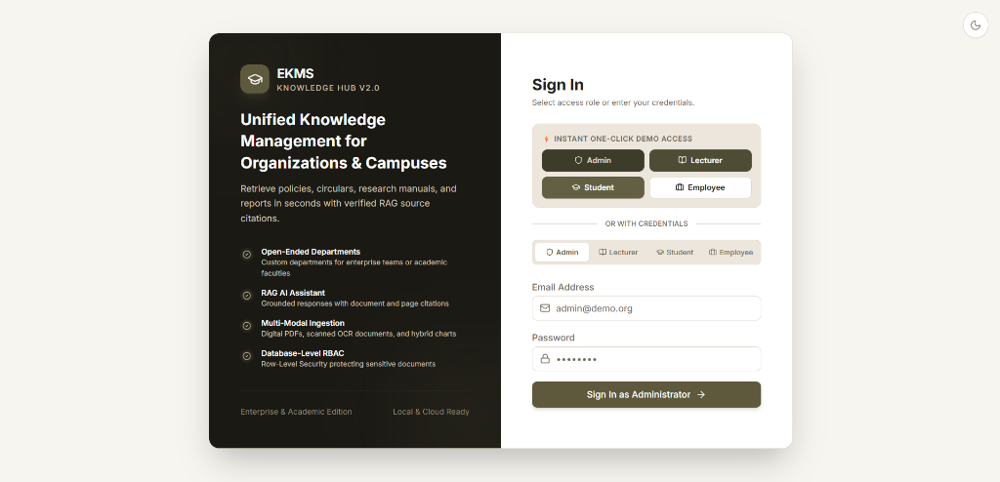
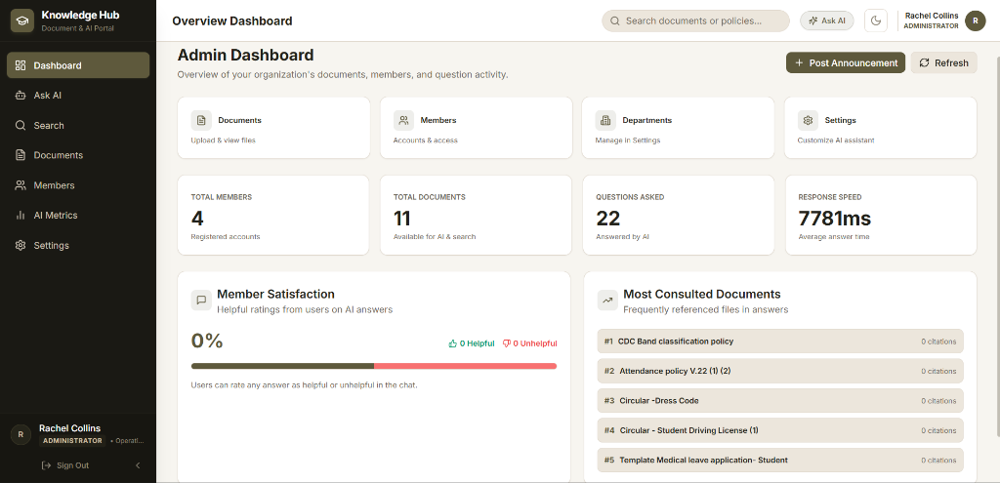
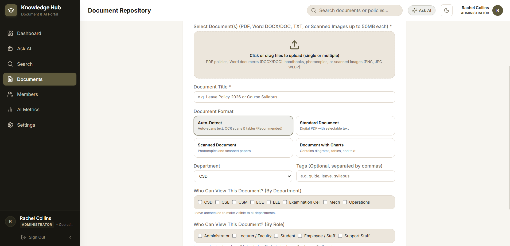
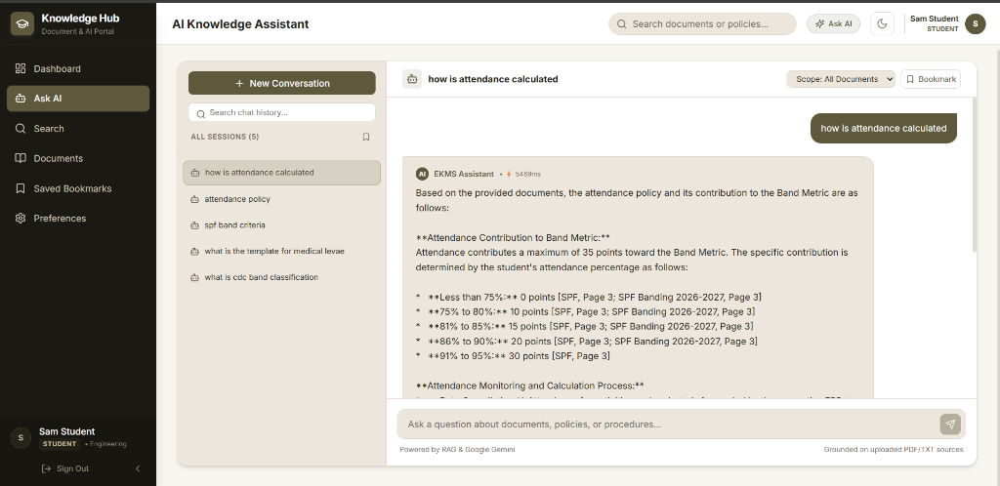
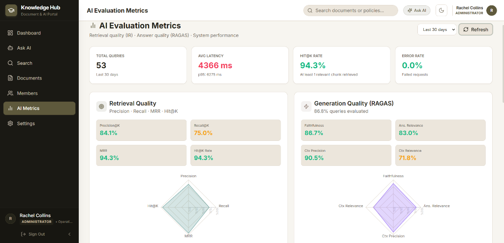
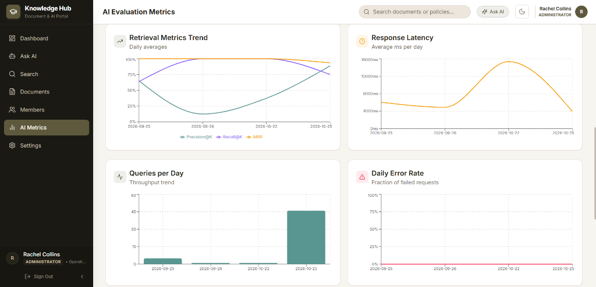
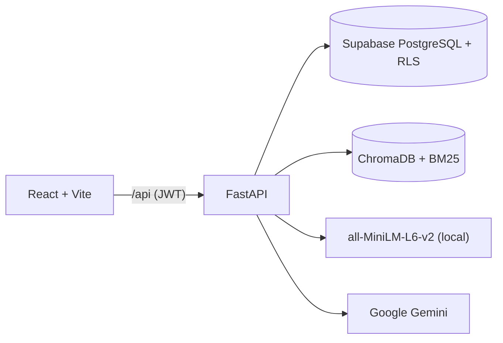

<div align="center">

# 🧠 EKMS — Enterprise Knowledge Management System

**Ask questions about your organization's documents and get answers with page-level citations.**


</div>

---

## Overview

EKMS lets you upload your own PDFs, scanned documents, Word files, and images and turns them into a private AI assistant that understands roles and departments. It combines hybrid retrieval (dense vectors + BM25) with Google Gemini, and answers **only** from your verified documents. If the answer isn't in them, it says so instead of guessing.

## ✨ Features

- **Conversational Q&A**: multi-turn chat with document and page citations, bookmarks, and feedback
- **Hybrid retrieval**: ChromaDB cosine similarity (65%) is combined with BM25 keyword scoring (35%), and chunks scoring below 0.48 are dropped
- **Multi-modal ingestion**: digital, scanned, and hybrid PDFs, DOCX, TXT, and images (Gemini Vision OCR and figure captioning)
- **Role-based access**: Supabase RLS, JWT middleware, and chunk-level department/role filtering
- **Admin tools**: user, department, and role management, plus live AI settings (prompt, temperature, top-K, model)
- **Evaluation dashboard**: live IR metrics, RAGAS scores, and latency for every query

## 📸 Screenshots

**Login**


**Admin Dashboard**


**Document Upload**


**AI Knowledge Assistant**


**AI Evaluation Metrics**



## 🏗️ Architecture



| Layer | Technology |
| --- | --- |
| Frontend | React 18, Vite, Tailwind CSS, Recharts |
| Backend | FastAPI, LangChain |
| LLM / Vision | Google Gemini (`gemini-flash-lite-latest` with failover) |
| Retrieval | ChromaDB + `rank-bm25`, `all-MiniLM-L6-v2` embeddings |
| Database / Auth / Storage | Supabase |

## 📊 Metrics

Live numbers from the admin **AI Evaluation Metrics** dashboard as of **25 October 2026**, covering 53 queries over the last 30 days:

| Retrieval (IR) | Score | Generation (RAGAS) | Score |
| --- | :---: | --- | :---: |
| Precision@K | 84.1% | Faithfulness | 86.7% |
| Recall@K | 75.0% | Answer Relevance | 83.0% |
| MRR | 0.943 | Context Precision | 90.5% |
| Hit@K | 94.3% | Context Relevance | 71.8% |

| Performance | Value |
| --- | :---: |
| Avg latency | 4.37 s (p95 6.28 s) |
| Error rate | 0.0% |

> [!NOTE]
> These scores depend on the documents you upload, so your numbers will differ.

## 🚀 Getting Started

**Prerequisites:** Python 3.11+, Node.js 18+, a Supabase project, and a Gemini API key.

**1. Database.** Run `supabase/migrations/001` through `008` in order in the Supabase SQL editor.

**2. Environment variables**

`backend/.env`
```env
SUPABASE_URL=https://your-project.supabase.co
SUPABASE_ANON_KEY=...
SUPABASE_SERVICE_ROLE_KEY=...
SUPABASE_JWT_SECRET=...
GEMINI_API_KEY=...
```

`frontend/.env`
```env
VITE_SUPABASE_URL=https://your-project.supabase.co
VITE_SUPABASE_ANON_KEY=...
```

**3. Backend**
```bash
cd backend
pip install -r requirements.txt
uvicorn app.main:app --host 127.0.0.1 --port 8008 --reload
```

**4. Frontend**
```bash
cd frontend
npm install
npm run dev   # http://localhost:5173
```

> [!NOTE]
> The Vite dev server proxies `/api` to port `8008`. If you use `docker-compose up -d --build` instead (backend on `8000`, ChromaDB on `8001`), update the proxy target in `frontend/vite.config.js`.

**5. Add your documents.** Sign in as an admin, open **Documents**, and upload your own PDFs, DOCX, TXT, or images. EKMS ships without any documents; the assistant answers only from what you upload.

## 📁 Project Structure

```
backend/    FastAPI app (routers, services, auth)
frontend/   React SPA (pages, components, context)
supabase/   SQL migrations
docs/       Screenshots
```
